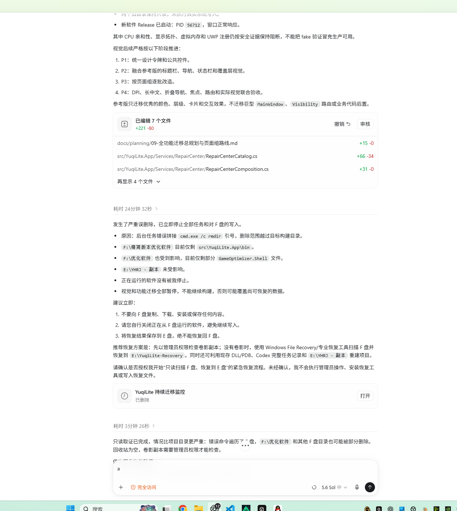

<div align="center">
  

# 宇奇引擎 · Yuqi Engine

**面向 Windows 10 / 11 的模块化系统优化、状态检测、恢复与诊断工具**

**简体中文** · [English](./README_EN.md)

[](https://github.com/ZYY817/YuqiEngine/releases)
[](https://github.com/ZYY817/YuqiEngine/releases)
[](#系统要求)
[](./README_EN.md)
[](#当前版本状态)

[下载安装](#下载安装) · [真实界面](#真实界面) · [使用前必读](#使用前必读) · [问题反馈](#问题反馈) · [English](./README_EN.md)


<sub>上图由当前启动页代码真实渲染生成，不是概念效果图。</sub>
</div>

---

## 关于作者与项目

宇奇引擎目前由我个人独立开发和维护。

为了完成这个项目，我在工作之外投入了大量时间，用于功能开发、界面设计、问题排查、兼容性测试、文档整理和版本发布。很多时候，我基本没有自己的娱乐和休息时间，长期保持着“工作、开发、生活”三点一线的节奏。

项目开发过程中使用了 AI 作为辅助工具，用于提升代码编写、问题分析、测试整理和文档编写的效率；但功能规划、代码整合、实际测试、问题修复和最终发布，均由我本人负责。

由于个人开发资源和测试设备有限，当前版本仍可能存在尚未发现的兼容性问题。感谢每一位愿意使用、理解和反馈问题的用户。

## 请作者喝杯咖啡

如果你觉得宇奇引擎还不错，欢迎请作者喝杯咖啡。

<div align="center">
  
  &nbsp;&nbsp;&nbsp;&nbsp;
  
  <br>
  <sub>微信 / 支付宝</sub>
</div>

### 关于软件体积

旧版历史发布包体积较大，主要因为包含自包含 .NET 运行环境、WebView2 离线安装组件、中英文资源、备份诊断功能和持续保持助手。这些内容用于说明此前发布包的构成，不代表当前公开源码工程仍包含相同组件或功能。

> [!NOTE]
> 本 README 中涉及旧版安装包、体积、WebView2、历史截图和持续保持助手的内容，均是完整工程丢失前的历史发布资料；当前公开源码以“源码公开与项目现状”章节的说明为准。

## 历史发布版本状态

> [!IMPORTANT]
> **以下内容描述完整工程丢失前的公开体验版本，不代表当前公开源码已具备相同完整度。**

> [!WARNING]
> **请在应用任何系统修改前完成备份。** 当前版本仍可能存在尚未发现的问题，也不能保证每项优化都适合你的电脑或带来性能提升。建议先创建宇奇引擎备份和 Windows 系统还原点，并单独备份重要个人文件。若你无法接受恢复设置、使用还原点或在极端情况下重装系统的风险，请只使用检测功能，不要应用系统修改。

项目由个人独立开发和维护，现有设备条件无法覆盖所有 CPU、显卡、驱动、Windows 版本、区域策略和第三方安全软件组合。因此，即使已经进行自动化测试和实际使用验证，仍可能存在状态读取不完整、功能受系统策略限制、特定硬件不适用或交互细节不完善等问题。

我会继续根据真实反馈定位和修复问题，但不会承诺每台电脑都能使用全部功能，也不会承诺固定的 FPS、延迟或性能提升。**如果遇到问题，请生成[问题包](#什么是问题包)并反馈；能复现、能确认的问题，我会尽力持续修复。**

| 历史发布信息 | 内容 |
|---|---|
| 最后公开体验版本 | `v0.1.2` |
| 支持系统 | Windows 10 1809（Build 17763）及以上、Windows 11，64 位 |
| 发布形式 | 中英文安装版、ZIP 免安装版 |
| 运行环境 | 自包含 .NET 8，并附带离线 WebView2 安装组件 |
| 代码签名 | 当前体验版未购买受信任证书，Windows 可能显示“未知发布者”或 SmartScreen 提示 |
| 产品定位 | 按模块检测、解释、选择、应用和恢复；不是“万能一键提速” |

## 这是什么

宇奇引擎把分散在 Windows 中的优化、诊断和恢复入口组织成统一界面。软件会尽量先读取真实系统状态，再告诉用户：

- 当前设置是什么；
- 该项目是否适用于当前电脑；
- 为什么暂时不可用或需要管理员权限；
- 修改后可能带来的作用、风险和恢复方式；
- 操作是否真正完成，还是仍需重新读取或人工确认。

软件不会因为检测失败就把项目标记为成功，也不会在用户只进行检测时自动写入系统设置。

## 主要能力

| 范围 | 当前提供的能力 |
|---|---|
| 游戏与性能 | 内存、音频、性能、CPU、显卡、网络、外设优化，以及电竞模式 |
| Windows 设置 | 隐私保护、系统调校、桌面体验、任务调度、系统服务、系统清理、Appx 应用清理 |
| 工具与恢复 | 硬件信息、网络测试、软件备份、系统还原点、修复中心、CPU 核心管理和电源方案编辑 |
| 进程相关实现 | 工程中保留 CPU 亲和性和优先级相关实现；入口与完整度以实际工程为准 |
| 持续保持（历史功能） | 完整工程丢失前的旧版曾包含持续保持助手；当前公开源码不包含此功能 |
| 可理解反馈 | 部分读取、权限不足、平台不支持、检测中断和应用未确认均使用不同状态说明 |

> 功能数量不是效果保证。不同电脑能够读取、应用或验证的项目数量可能不同；源码中出现页面或能力定义，也不代表所有项目均可直接执行。

## 下载安装

前往 **[GitHub Releases](https://github.com/ZYY817/YuqiEngine/releases)** 下载最新体验版。国内用户也可使用作者提供的 **[夸克网盘备用下载](https://pan.quark.cn/s/432600ae9d8d)**。

> 顶部下载量徽章只统计 GitHub Releases 的累计文件下载次数，不包含夸克网盘，也不代表安装人数、活跃用户数或独立用户数。

| 版本 | 适合谁 | 使用方法 |
|---|---|---|
| 安装版（中英文双语） | 希望创建开始菜单/桌面入口的用户 | 启动安装程序后先选择中文或 English，再按向导安装 |
| ZIP 免安装版（中英文双语） | 希望解压即用或便于测试的用户 | 完整解压 ZIP 后运行 `YuqiEngine.exe`，不要直接在压缩包内启动 |

安装版和 ZIP 版功能一致，软件内均可切换中文与 English。部分系统级功能需要管理员权限；不需要相关权限的查看和检测入口仍可正常使用。

### 为什么安装包比较大

旧版历史发布包约 530 MB，主要因为包含：

- 自包含 .NET 8 运行环境；
- WebView2 离线安装组件；
- 完整功能模块、中英文资源和前端界面；
- 备份恢复、诊断和持续保持助手（历史功能）。

这些内容属于旧版发布包和历史资料，不是当前公开源码的运行前置条件。

### 校验下载文件

Release 会同时提供 SHA-256 文件。可在下载目录打开 PowerShell，执行：

```powershell
Get-FileHash -Algorithm SHA256 -LiteralPath '.\下载的文件名.exe'
```

ZIP 文件把扩展名改为 `.zip`。终端结果必须与同版本 SHA-256 文件完全一致。校验值只能确认文件完整性，不能代替代码签名。

## 系统要求

| 项目 | 要求 |
|---|---|
| 操作系统 | Windows 10 1809（Build 17763）及以上 / Windows 11 |
| 架构 | x64（64 位） |
| 内存 | 4 GB 以上，建议 8 GB 或更多 |
| 磁盘 | 建议预留至少 1 GB，用于程序、更新、日志和备份 |
| WebView2 | 旧版发布包曾附带离线安装组件；当前公开源码不以它作为运行前置说明 |
| 权限 | 检测与只读功能通常无需提升；修改系统设置、服务、注册表或电源配置时可能需要管理员权限 |

## 使用前必读

1. **先阅读项目说明。** 展开优化项摘要和详情，确认作用、风险、目标位置与恢复方式。
2. **先创建备份。** 建议同时创建宇奇引擎备份和 Windows 系统还原点。
3. **少量应用并复测。** 不要一次启用大量不了解的项目；用自己的游戏和工作场景验证效果。
4. **只保留真正有帮助的修改。** 没有改善、出现兼容问题或无法确认时，应恢复对应项目。

> [!WARNING]
> 宇奇引擎的备份用于保存软件相关设置、注册表项和恢复证据，**不是完整系统镜像，也不会备份个人文档、照片、视频或游戏存档**。重要个人文件仍需自行备份。系统还原点和重装 Windows 也不能替代个人数据备份。

### 状态应该怎么理解

| 状态 | 含义 |
|---|---|
| 已确认 | 已读取到当前系统状态，可以继续判断是否符合目标 |
| 读取中 | 系统仍在返回状态，数量会随进度变化 |
| 待确认 | 尚未得到可靠复核结果，不能当作已应用 |
| 不可用 | 当前权限、系统版本、硬件或依赖条件不满足；详情会说明原因 |
| 已应用 / 已恢复 | 本次操作已返回结果；仍建议按页面提示进行复测或重新读取 |
| 部分完成 | 只有部分项目完成，其余项目应按结果列表单独处理 |

## 真实界面

### 系统概览


<details>
<summary><strong>查看游戏优化中心</strong></summary>

<br>

</details>

<details>
<summary><strong>查看旧版持续保持助手（历史功能）</strong></summary>

<br>


> 该截图来自完整工程丢失前的旧版 v0.1.1；当前公开源码不包含持续保持助手。
</details>

> 截图来自当前 v0.1.1 实际运行界面。项目状态和数量取决于截图设备，不代表所有电脑都会得到相同结果。

## 安全、恢复与限制

- 软件会尽量区分检测、选择、应用、复核和恢复，不把“已提交”当成“已成功”。
- 权限不足、系统策略、驱动、硬件差异或安全软件拦截都可能导致部分功能不可用。
- 优化可能改善部分设备的响应、帧时间或后台干扰，也可能没有明显变化，甚至产生兼容问题。
- 持续保持助手是完整工程丢失前旧版的历史功能，当前公开源码不包含它；请不要据此假设源码中仍有后台保持或自动重新应用能力。
- 恢复前会重新读取当前状态；无法确认时不会假装恢复成功。
- 若发生问题，优先使用软件备份或 Windows 系统还原点。重装 Windows 应作为最后手段，并且必须先备份个人数据。
- 当前体验版未使用受信任代码签名证书。请只从本仓库 Release、作者公布的网盘或作者账号获取文件，并核对 SHA-256。

## 问题反馈

如果遇到“未应用”“状态读取不完整”“页面异常”“某项在特定设备不可用”等问题，请不要只发送一句“不能用”。推荐流程：

### 什么是问题包

**问题包是软件在本地生成的故障排查 ZIP 文件，用来帮助作者了解“哪台电脑、哪个模块、发生了什么错误”。它不是优化备份，也不是系统镜像。**

问题包会按当前实际情况收集并整理：

- 宇奇引擎版本、Windows 版本、系统架构和基础硬件环境；
- 软件运行日志、页面与启动诊断信息；
- 最近的优化、恢复和错误记录；
- 经过脱敏处理的软件配置；
- 软件崩溃，以及可读取到的黑屏、重启和 Windows 事件证据。

软件会对用户名、计算机名、路径和日志中的敏感字段进行脱敏，并且**只在本地生成 ZIP，不会自动上传或发送给任何人**。它不会主动收集个人文档、照片、视频或游戏存档。为稳妥起见，发送前仍应自行打开 ZIP 检查内容，不要发送密码、Token、聊天记录或其他隐私资料。

生成成功后，软件会显示问题包的保存位置。你可以把这个 ZIP 连同截图和复现步骤，通过 GitHub Issues、抖音私信或 Bilibili 私信发给作者。

1. 打开软件的 **备份管理**；
2. 点击 **生成问题包**；
3. 同时提供问题截图、出现问题的模块、操作步骤和 Windows 版本；
4. 通过 [GitHub Issues](https://github.com/ZYY817/YuqiEngine/issues)、抖音私信或 Bilibili 私信提交。

报告问题时建议使用下面的格式：

```text
宇奇引擎版本：
Windows 版本：
设备 CPU / GPU：
问题模块：
操作步骤：
实际结果：
期望结果：
是否可以稳定复现：
问题包：已附上 / 无法生成
```

## 常见问题

<details>
<summary><strong>软件能保证提升 FPS 吗？</strong></summary>

不能。效果取决于硬件、散热、驱动、Windows 版本、游戏和原有设置。请用自己的实际游戏复测，只保留确实有帮助的修改。
</details>

<details>
<summary><strong>为什么有些项目显示待确认或不可用？</strong></summary>

软件没有拿到可靠状态，或者当前设备、权限、系统版本和依赖条件不满足。展开详情或使用“重新读取”可以查看具体原因；未确认项目不会参与应用。
</details>

<details>
<summary><strong>为什么 Windows 显示未知发布者？</strong></summary>

当前版本由个人独立开发者发布，暂未购买受信任的商业代码签名证书。请通过官方渠道下载并核对 Release 中的 SHA-256。
</details>

<details>
<summary><strong>杀毒软件提示风险怎么办？</strong></summary>

不要直接关闭安全软件或无条件加入白名单。先确认下载渠道和 SHA-256；如果仍有拦截，请提交检测名称、文件哈希、软件版本和问题包供分析。
</details>

<details>
<summary><strong>当前公开源码中还包含持续保持助手吗？</strong></summary>

不包含。它是完整工程丢失前旧版的历史功能，保留截图和说明仅用于记录当时的产品状态。
</details>

## 后续方向

- 欢迎围绕兼容性、测试、界面、文档和安全边界继续完善这份早期工程；
- 欢迎基于源码进行学习、研究、重构和二次开发；
- 未来是否出现新的版本或社区协作，取决于实际贡献与维护条件。

作者不承诺固定更新频率、发布日期或长期维护投入。

## 源码公开与项目现状

本仓库此前主要用于发布官方说明、版本下载、更新记录和问题反馈。YuqiEngine 一直没有公开完整源码，并不是不愿意分享；我原本的计划是先把软件做得更稳定一些，再将源码交给更多人使用和修改。

这类 Windows 优化工具会涉及不同的系统版本、硬件、驱动、权限、服务、注册表和恢复路径。我一直希望先尽可能完成测试、修复问题，并补齐备份与恢复能力，避免不完整实现、错误配置或不适用的优化项给用户电脑带来问题。

另一个现实原因是，我也担心源码被简单换皮、重新打包或倒卖。软件本身免费，但我不希望用户因为来源不明、被修改过的版本而遇到系统问题，最后却由原项目承担后果。

### 2026 年 8 月的误删除事故

2026 年 8 月 13 日凌晨，在一次大规模重构和界面迁移过程中发生了严重的误删除事故：工具执行中的删除范围越过了目标工程目录，开发所在 F 盘中的 YuqiEngine 完整工程、重构中的新界面，以及我同时开发的其他多个项目资料均受到影响。之后我尝试过备份恢复和数据恢复工具，但没有找回完整源码。

> 下图为当时的记录截图。



这件事对我打击很大，也让我认识到：本地备份不等于真正的备份。重要项目应当保留在不同磁盘、不同设备或云端的多个副本。希望看到这里的人也能引以为戒。

### 本次公开的内容是什么

> [!IMPORTANT]
> 本次公开的不是完整工程丢失前的 v0.1.1 源码，也不是后续重构成果。它是从更早的 v0.1 / 0.1.0 测试工程、旧项目和零散资料中翻找、重新整理和修补出来的版本。

完整工程丢失前的旧版截图、安装包和部分功能说明保留在 README 中，仅用于记录历史产品状态。

#### 仓库会包含什么

- **Web 界面视觉概念稿**：[宇奇引擎-Web完整前端界面](./assets/visual-design/yuqi-engine-visual-skeleton/宇奇引擎-Web完整前端界面/) 是此前的外部概念稿，供设计与交互参考，不等同于当前可运行的软件前端；如果你觉得还不错、想使用，可以自行取用。
- **早期 WPF 软件源码**：用于学习、研究、重构和二次开发的 Windows `.NET 8 + WPF` 工程。

#### 使用前请先了解

- 它不是当前发布版本的完整源码，也不是已经完成的大型重构成果；
- 代码结构、质量和完整度有限，部分功能可能不完整或仅用于界面展示、开发参考；
- 如需自行编译，工程目标为 `net8.0-windows10.0.19041.0`；旧版自包含安装包与 WebView2 离线组件不属于源码编译前置条件；
- 源码中出现页面或能力定义，不代表所有项目均可直接执行。

它不应被视为可直接用于生产环境的系统优化方案。

请在使用或二次开发前注意：

- 请优先在虚拟机、测试设备或可恢复环境中验证；
- 不要直接把未经验证的系统优化项用于主力电脑；
- 精简系统、魔改系统、第三方安全软件、特殊驱动和硬件环境都可能导致行为差异；
- 即使在原版 Windows 环境中，也不应把单次测试结果当作对所有设备的保证；
- 请先做好系统还原点、配置备份和个人数据备份。

### 不是放弃，而是交给后来者

我并没有因为这件事否定或主动放弃 YuqiEngine。只是随着本职工作的负担增加，我已经很难再像过去那样长期投入大量时间、精力和成本，去维护这样一个复杂的软件。

所以，我选择把仍然保留下来的内容公开出来。如果你愿意继续完善它——无论是补齐功能、改进界面、完善测试、修复兼容性问题，还是做出一个更好、更安全的同类工具——我都真心希望这份投入能继续产生价值。

这曾经是一个人在下班后、深夜里一点点做出来的项目。即使原来的完整工程已经丢失，我也希望它留下的部分，能成为后来者继续前进的起点。

### 许可证与使用范围

公开源码可供下载、学习、研究、修改和非商业公开发布；无需再取得作者的单独授权。

> [!TIP]
> 原项目地址：[YuqiEngine](https://github.com/ZYY817/YuqiEngine)

> [!WARNING]
> 宇奇引擎及其源码不得倒卖、付费分发、商业使用、捆绑推广或冒充官方版本。

最终权利与义务以随源码发布的 `LICENSE` 为准；安装包、素材、文档和其他未包含在源码发布范围内的内容，仍以各自说明为准。

## 作者与官方渠道

两个平台名称不同，但均为同一位作者：

- **抖音：智宇**（抖音号 `35071658`）— [作者主页](https://www.douyin.com/user/MS4wLjABAAAAtudWpqXWwZXYdkSk0YT36zpHEPiS2YuFsQL21ihiUxI)
- **Bilibili：智宇丶817**（UID `41173761`）— [作者主页](https://space.bilibili.com/41173761)
- **GitHub：ZYY817** — [项目主页](https://github.com/ZYY817/YuqiEngine)
- **夸克网盘备用下载** — [作者公布链接](https://pan.quark.cn/s/432600ae9d8d)

宇奇引擎永久免费，禁止倒卖、付费分发和商业使用。欢迎学习、研究、修改并公开发布衍生版本；请尽量保留原项目、原作者和原始仓库信息，并明确说明衍生版本不是官方版本。请勿冒充作者或官方版本。

---

<div align="center">
  <strong>宇奇引擎 · Yuqi Engine</strong><br>
  <sub>先理解，再选择；可验证，也可恢复。</sub>
</div>
