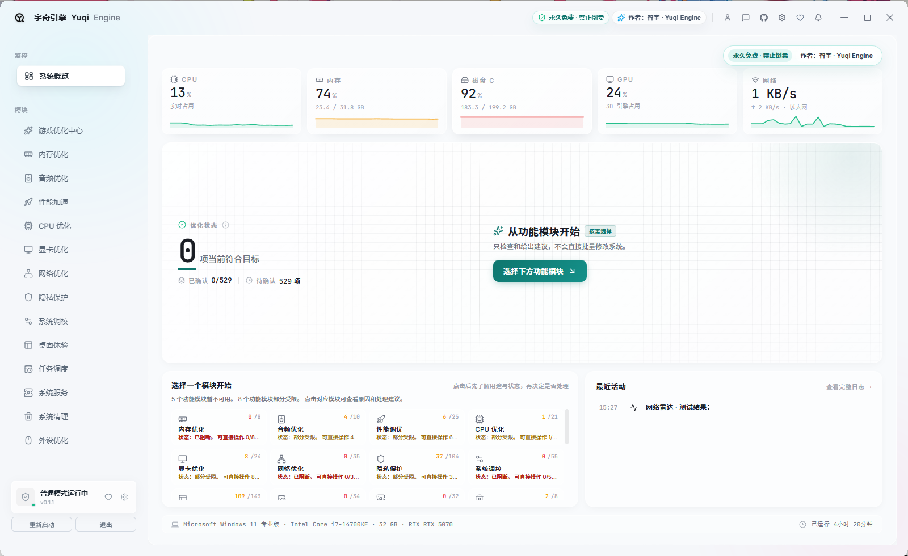
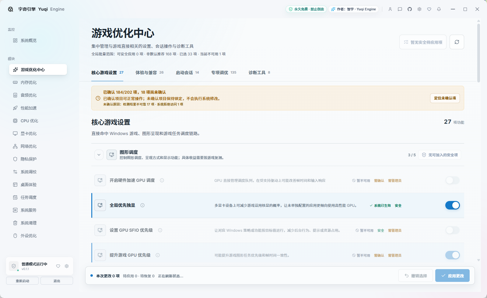
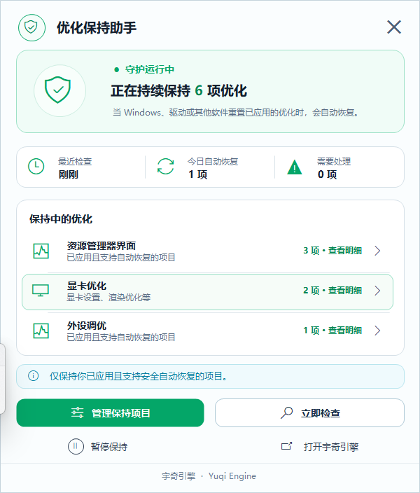

<div align="center">
  

# Yuqi Engine

**A modular Windows 10 / 11 utility for system optimization, status checks, recovery, and diagnostics**

[简体中文](./README.md) · **English**

[](https://github.com/ZYY817/YuqiEngine/releases)
[](https://github.com/ZYY817/YuqiEngine/releases)
[](#system-requirements)
[](./README.md)
[](#current-release-status)

[Download](#download-and-install) · [Screenshots](#screenshots) · [Before You Use It](#before-you-use-it) · [Report an Issue](#report-an-issue) · [简体中文](./README.md)


<sub>The animation above is rendered from the actual startup screen, not a concept image.</sub>
</div>

---

## About the Author and the Project

Yuqi Engine is independently developed and maintained by one person.

This project is built outside working hours. A significant amount of time has gone into feature development, UI design, issue investigation, compatibility testing, documentation, and releases. Much of that work has come at the cost of personal entertainment and rest, following a long-term work–development–life routine.

AI is used as an assistant for coding, issue analysis, test organization, and documentation. However, feature planning, code integration, hands-on testing, bug fixes, and final releases are handled by the author.

Because this is an independently developed project with limited devices and testing resources, compatibility issues may still exist. Thank you to everyone who uses the software, understands its limits, and submits useful feedback.

### About the Package Size

The historical release package was relatively large because it included a self-contained .NET runtime, an offline WebView2 installer, bilingual resources, backup and diagnostics features, and the protection assistant. These details describe the earlier package only; they do not mean that the currently released source tree contains the same components or features.

> [!NOTE]
> References in this README to earlier installers, package size, WebView2, historical screenshots, and the protection assistant describe releases made before the complete project was lost. The current public source is defined by the “Source Release and Project Status” section below.

## Buy the Author a Coffee

If you think Yuqi Engine is useful, you are welcome to buy the author a coffee.

<div align="center">
  
  &nbsp;&nbsp;&nbsp;&nbsp;
  
  <br>
  <sub>WeChat / Alipay</sub>
</div>

## Historical Release Status

> [!IMPORTANT]
> **The following section describes public preview releases made before the complete project was lost. It does not mean that the current public source has the same completeness.**

> [!WARNING]
> **Back up your system before applying any system changes.** This version may still contain undiscovered issues. It cannot guarantee that every optimization is suitable for your computer or improves performance. Create a Yuqi Engine backup and a Windows restore point first, and separately back up important personal files. If you cannot accept the risk of restoring settings, using a restore point, or—in extreme cases—reinstalling Windows, use detection features only and do not apply system changes.

The project is independently developed and maintained. Available test devices cannot cover every CPU, GPU, driver, Windows version, regional policy, or third-party security software combination. Even after automated and hands-on testing, status reads may be incomplete, features may be restricted by system policy, certain hardware may be unsupported, or interaction details may need improvement.

Real feedback will continue to guide fixes, but the author cannot promise that every computer can use every feature, or that a fixed FPS, latency, or performance improvement will result. **If you encounter an issue, create an [issue package](#what-is-an-issue-package) and report it. Reproducible and verified issues will be addressed whenever possible.**

| Historical release information | Details |
|---|---|
| Last public preview | `v0.1.2` |
| Supported systems | Windows 10 1809 (Build 17763) and later, Windows 11, 64-bit |
| Distribution | Bilingual installer and portable ZIP |
| Runtime | Self-contained .NET 8 with an offline WebView2 installer |
| Code signing | This preview does not yet use a trusted signing certificate. Windows may show “Unknown publisher” or a SmartScreen prompt. |
| Product approach | Detect, explain, select, apply, and restore by module; it is not a “one-click miracle booster.” |

## What Is It?

Yuqi Engine brings Windows optimization, diagnostics, and recovery tools into one interface. It tries to read the actual system state before telling you:

- What the current setting is;
- Whether an item applies to your computer;
- Why an item is temporarily unavailable or requires administrator rights;
- What a change may do, what risks it carries, and how to restore it;
- Whether an operation has actually completed or still needs another read or manual confirmation.

The software does not mark an item as successful merely because detection failed, and it does not write system settings when you are only checking status.

## Main Capabilities

| Area | Available capabilities |
|---|---|
| Gaming and performance | Memory, audio, performance, CPU, graphics, network, and peripheral optimization, plus Esports Mode |
| Windows settings | Privacy, system tuning, desktop experience, task scheduling, system services, cleanup, and Appx cleanup |
| Tools and recovery | Hardware information, network tests, software backups, Windows restore points, repair center, CPU core management, and power-plan editor |
| Process-related implementation | The project retains CPU-affinity and priority-related implementations; entry points and completeness depend on the actual source tree |
| Ongoing protection (historical) | The earlier complete build included a protection assistant; the current public source does not include this feature |
| Clear feedback | Partial reads, insufficient permissions, unsupported platforms, interrupted detection, and unconfirmed application results are presented as distinct states |

> The number of features is not a guarantee of results. The number of items that can be read, applied, or verified may differ between computers. A page or capability definition in the source does not mean that every item can be executed directly.

## Download and Install

Download the latest preview from **[GitHub Releases](https://github.com/ZYY817/YuqiEngine/releases)**. Users in mainland China can also use the author-provided **[Quark Drive mirror](https://pan.quark.cn/s/432600ae9d8d)**.

> The download badge at the top counts cumulative GitHub Release asset downloads only. It does not include Quark Drive downloads and does not represent installs, active users, or unique users.

| Version | Best for | How to use |
|---|---|---|
| Installer (Chinese / English) | Users who want Start menu or desktop shortcuts | Start the installer, choose Chinese or English, and follow the setup wizard |
| Portable ZIP (Chinese / English) | Users who prefer extraction-only use or testing | Fully extract the ZIP, then run `YuqiEngine.exe`; do not start it inside the archive |

The installer and ZIP provide the same features. Both can switch between Chinese and English inside the app. Some system-level features require administrator rights; read-only and detection features can still work without elevation.

### Why Is the Installer So Large?

The historical release package was about 530 MB because it included:

- A self-contained .NET 8 runtime;
- An offline WebView2 installer;
- Complete modules, bilingual resources, and the web-based UI;
- Backup, recovery, diagnostics, and the protection assistant (a historical feature).

These components belong to the earlier release package and historical materials; they are not runtime prerequisites for the current public source.

### Verify Downloaded Files

Each release includes SHA-256 files. Open PowerShell in the download folder and run:

```powershell
Get-FileHash -Algorithm SHA256 -LiteralPath '.\your-downloaded-file.exe'
```

For a ZIP, replace the extension with `.zip`. The result must exactly match the SHA-256 file for that release. A hash verifies file integrity; it does not replace code signing.

## System Requirements

| Item | Requirement |
|---|---|
| Operating system | Windows 10 1809 (Build 17763) or later / Windows 11 |
| Architecture | x64 (64-bit) |
| Memory | 4 GB minimum; 8 GB or more recommended |
| Disk space | At least 1 GB recommended for the app, updates, logs, and backups |
| WebView2 | Earlier release packages included an offline installer; it is not described as a prerequisite for the current public source |
| Permissions | Detection and read-only features usually do not need elevation; editing system settings, services, the registry, or power settings may require administrator rights |

## Before You Use It

1. **Read the item description first.** Expand summaries and details to understand the effect, risk, target location, and recovery method.
2. **Create backups first.** Creating both a Yuqi Engine backup and a Windows restore point is recommended.
3. **Apply a small number of changes and retest.** Do not enable many unfamiliar items at once; test with your own games and work scenarios.
4. **Keep only changes that truly help.** Restore an item if it brings no improvement, causes compatibility issues, or cannot be verified.

> [!WARNING]
> Yuqi Engine backups store app-related settings, registry entries, and recovery evidence. **They are not full system images and do not back up personal documents, photos, videos, or game saves.** Important personal data must still be backed up separately. Windows restore points and reinstalling Windows are not substitutes for personal-data backups.

### Understanding Statuses

| Status | Meaning |
|---|---|
| Confirmed | The current system state was read and can be evaluated against the target |
| Reading | The system is still returning status; counts may change as progress continues |
| Unconfirmed | No reliable verification result is available yet; it must not be treated as applied |
| Unavailable | Current permissions, Windows version, hardware, or dependencies do not meet requirements; details explain why |
| Applied / Restored | The operation returned a result; follow page guidance to retest or read again when needed |
| Partially completed | Only some items completed; handle remaining items individually using the result list |

## Screenshots

### System Overview



<details>
<summary><strong>View Game Optimization Hub</strong></summary>

<br>

</details>

<details>
<summary><strong>View Protection Assistant</strong></summary>

<br>

</details>

> Screenshots are from an actual v0.1.1 session. Item statuses and counts depend on the device shown and will not be identical on every computer.

## Safety, Recovery, and Limitations

- The software tries to distinguish detection, selection, application, verification, and restoration. “Submitted” is not presented as “successful.”
- Insufficient permissions, system policies, drivers, hardware differences, or security software can make some features unavailable.
- Optimizations may improve responsiveness, frame times, or background interference on some devices, but may show no visible change or cause compatibility problems.
- The protection assistant was a historical feature of the complete build that was lost; the current public source does not include it. Do not assume that this source contains background protection or automatic reapplication.
- The app reads the current state again before restoring. It does not pretend that recovery succeeded when it cannot verify the result.
- If something goes wrong, use a Yuqi Engine backup or a Windows restore point first. Reinstalling Windows should be the last resort, and personal data must be backed up first.
- This preview does not use a trusted signing certificate. Download only from this repository’s Releases page, the author’s published mirror, or the author’s accounts, and verify SHA-256 hashes.

## Report an Issue

If you encounter an item that was not applied, incomplete status reads, page errors, or a feature that is unavailable on specific hardware, please do not report only “it does not work.”

### What Is an Issue Package?

**An issue package is a ZIP file created locally by the software to help the author determine which computer, module, and error are involved. It is not an optimization backup or a system image.**

Depending on what is available, it collects and organizes:

- Yuqi Engine version, Windows version, system architecture, and basic hardware environment;
- App logs, page diagnostics, and startup diagnostics;
- Recent optimization, restoration, and error records;
- Redacted app configuration;
- Crash evidence and available black-screen, restart, and Windows Event evidence.

The app redacts usernames, computer names, paths, and sensitive log fields. **The ZIP is created locally only; it is never uploaded or sent automatically.** It does not intentionally collect personal documents, photos, videos, or game saves. Before sending, open the ZIP and inspect it yourself. Do not send passwords, tokens, chat records, or other private materials.

After creating the package, the app shows its save location. Send the ZIP together with screenshots and reproduction steps through GitHub Issues, Douyin direct messages, or Bilibili direct messages.

1. Open **Backup Management** in the app;
2. Select **Generate Issue Package**;
3. Include screenshots, the affected module, reproduction steps, and your Windows version;
4. Submit through [GitHub Issues](https://github.com/ZYY817/YuqiEngine/issues), Douyin direct messages, or Bilibili direct messages.

Use this template when reporting an issue:

```text
Yuqi Engine version:
Windows version:
CPU / GPU:
Affected module:
Steps to reproduce:
Actual result:
Expected result:
Can it be reproduced consistently?
Issue package: attached / unable to generate
```

## Frequently Asked Questions

<details>
<summary><strong>Can the software guarantee higher FPS?</strong></summary>

No. Results depend on hardware, cooling, drivers, Windows version, games, and existing settings. Test with your own games and keep only changes that demonstrably help.
</details>

<details>
<summary><strong>Why are some items unconfirmed or unavailable?</strong></summary>

The app may not have obtained a reliable state, or the current device, permissions, Windows version, or dependencies may not meet requirements. Expand details or use “Read again” to see the reason. Unconfirmed items are not applied.
</details>

<details>
<summary><strong>Why does Windows show an unknown publisher warning?</strong></summary>

This version is published by an independent developer and does not yet have a trusted commercial code-signing certificate. Download through official channels and verify the SHA-256 hash in Releases.
</details>

<details>
<summary><strong>What should I do if antivirus software reports a risk?</strong></summary>

Do not immediately disable security software or add an unconditional allow rule. Verify the download source and SHA-256 first. If the warning persists, send the detection name, file hash, software version, and an issue package for investigation.
</details>

<details>
<summary><strong>Does the current public source still include the protection assistant?</strong></summary>

No. It was a historical feature of the complete build that was lost. Its screenshot and description remain only to record the earlier product state.
</details>

## Future Direction

- Contributions that improve compatibility, testing, UI, documentation, and safety boundaries are welcome;
- Learning, research, refactoring, and secondary development from this early codebase are welcome;
- Whether new versions or community collaboration emerge depends on actual contributions and maintenance conditions.

The author does not promise a fixed update cadence, release date, or long-term maintenance commitment.

## Source Release and Project Status

This repository was previously used mainly for official information, releases, changelogs, and issue feedback. YuqiEngine did not publish its complete source code, not because I was unwilling to share it. My original plan was to make the software more stable first, then let more people use and modify the source.

A Windows optimization tool has to account for different operating-system versions, hardware, drivers, permissions, services, registry settings, and recovery paths. I wanted to complete as much testing and bug fixing as possible, and to strengthen backup and recovery support before opening the code. The goal was to reduce the risk of incomplete implementations, incorrect configuration, or unsuitable optimization items causing problems on users' computers.

There was also a practical concern that the source could be lightly reskinned, repackaged, or resold. The software itself is free, but I do not want users to encounter system problems after using altered or unofficial builds and then attribute those problems to the original project.

### The accidental deletion in August 2026

During a large refactor and UI migration in the early hours of August 13, 2026, a serious accidental deletion occurred. The deletion scope executed by a tool extended beyond the intended project directory. The complete YuqiEngine development project, the new UI being migrated, and several other projects stored on the development F drive were affected. I tried backup recovery and data-recovery tools afterwards, but the complete source could not be recovered.

> A screenshot of the contemporaneous record will be added here to explain the incident. It is provided only as factual context and contains no user-private information.

The loss was painful, but it reinforced an important lesson: a local backup is not a complete backup strategy. Important projects should have multiple copies across separate disks, devices, or cloud storage. I hope this helps others avoid the same mistake.

### What is being released

> [!IMPORTANT]
> This release is not the v0.1.1 source that existed before the complete project was lost, nor is it the later refactor. It was found, reconstructed, and repaired from an earlier v0.1 / 0.1.0 test project, old project files, and scattered materials.

Earlier screenshots, installers, and some feature descriptions in this README remain only as historical product records from before the complete project was lost.

#### What the repository will contain

- **Web UI visual concept draft**: design and interaction reference for the earlier web UI; it is not a runnable current frontend;
- **Early WPF software source**: a Windows `.NET 8 + WPF` project for learning, research, refactoring, and secondary development.

#### Before you use it

- It is neither the complete source for the currently released application nor the completed refactor;
- Its structure, quality, and completeness are limited; some features may be incomplete or intended only for UI presentation and development reference;
- If you build it yourself, it targets `net8.0-windows10.0.19041.0`; the earlier self-contained installer and offline WebView2 component are not prerequisites for building the source;
- A page or capability definition in the source does not mean that every item can be executed directly.

It must not be treated as a production-ready Windows optimization solution.

Before using or developing from it:

- Prefer a virtual machine, test device, or recoverable environment;
- Do not apply unverified system-optimization items to a primary computer;
- Stripped or modified Windows builds, third-party security software, special drivers, and hardware differences can all change behavior;
- Even on an unmodified Windows installation, a one-time test is not a guarantee for every device;
- Create a system restore point and back up configuration and personal data first.

### Not abandonment, but a handoff

I have not rejected or deliberately abandoned YuqiEngine. However, growing responsibilities in my day job mean I can no longer invest the same long-term time, energy, and cost into maintaining such a complex application.

That is why I am releasing the material that remains. If you want to carry it forward—by filling in features, improving the UI, adding tests, fixing compatibility problems, or creating a better and safer tool—I sincerely hope this work can continue to have value.

This was a project built little by little after work and late at night. Even though the complete original project is gone, I hope what remains can become a starting point for those who continue it.

### License and permitted use

The published source may be downloaded, studied, researched, modified, and publicly released for non-commercial purposes without separate permission from the author.

> [!TIP]
> Whenever practical, retain the original project name **YuqiEngine**, the original author **智宇 / ZYY817**, and the original repository link in a README, release note, or other prominent place. Clearly state that your modified version is not an official release.

> [!WARNING]
> YuqiEngine and its source may not be resold, distributed for payment, used commercially, bundled for promotion, or presented as an official release.

The final rights and obligations are defined by the `LICENSE` published with the source. Installers, assets, documents, and other material outside the published source scope remain subject to their own notices.

## Author and Official Channels

The following accounts belong to the same author:

- **Douyin: 智宇** (Douyin ID `35071658`) — [Author page](https://www.douyin.com/user/MS4wLjABAAAAtudWpqXWwZXYdkSk0YT36zpHEPiS2YuFsQL21ihiUxI)
- **Bilibili: 智宇丶817** (UID `41173761`) — [Author page](https://space.bilibili.com/41173761)
- **GitHub: ZYY817** — [Project page](https://github.com/ZYY817/YuqiEngine)
- **Quark Drive mirror** — [Author-published link](https://pan.quark.cn/s/432600ae9d8d)

Yuqi Engine is permanently free. Resale, paid distribution, and commercial use are prohibited. Learning, research, modification, and public release of derivative versions are welcome; please retain the original project, author, and repository information whenever practical, and clearly state that a derivative version is not official. Do not impersonate the author or an official release.

---

<div align="center">
  <strong>Yuqi Engine</strong><br>
  <sub>Understand first, then choose. Verifiable and recoverable.</sub>
</div>


